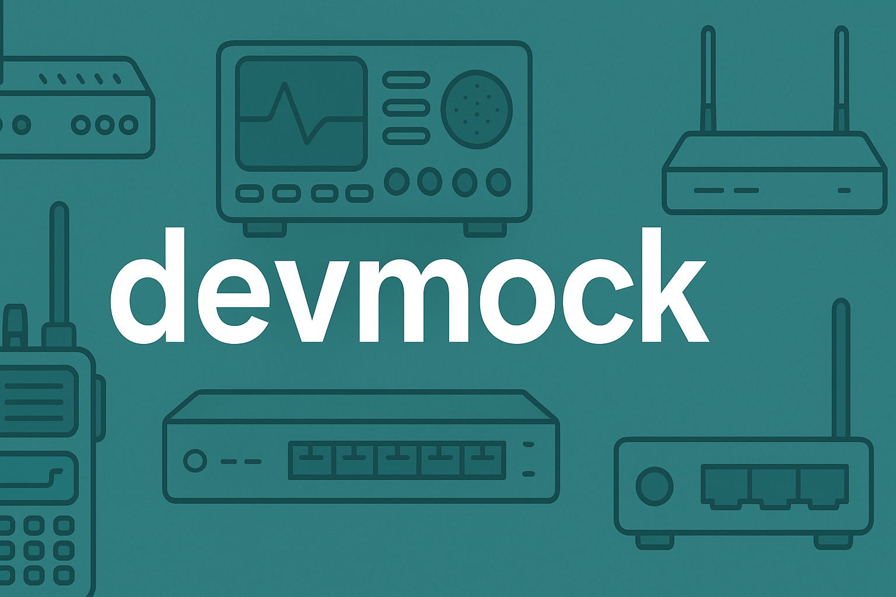

## Goal
The main goal of this project is to simulate basic field devices without the complex task of setting up VM or complex docker/podman containers. This devices can be used in CI/CD validations or local developments environments where the real devices are not accesible. 

Each device configuration should be as simple as:
- defining a json file with the expected request/response commands.
- compile the base docker image with this JSON file.

## Device capabilities:
A device:
- provide both SSH and Telnet protocols as remote connections.
- provide a simple command-line interface (CLI).
- process user commands via a pre-mapped/user-defined JSON file.

Example of real production devices can be:
- Digital Radios that can only be accesed via Telnet
- Switches accesed via SSH and Telnet but are securized with TACACS+ or RADIUS
- Routers that are accesed via SSH

# Registry Images
TODO

# Development
## Requirements
- Minimum Python version 3.13

## Init project
1. Install project packages
```bash
pipenv install
```
2. Setup the `pipenv` virtual environment for the project
    - With VSC set the environment in the `Python environment tab`
    - With other IDE execute `pipenv shell` on the terminal

## Run project
1. Launch the project
```bash
python -m src.main
```

## Execute tests
```bash
pytest
# or a specific file
pytest tests/test_commands.py
```
